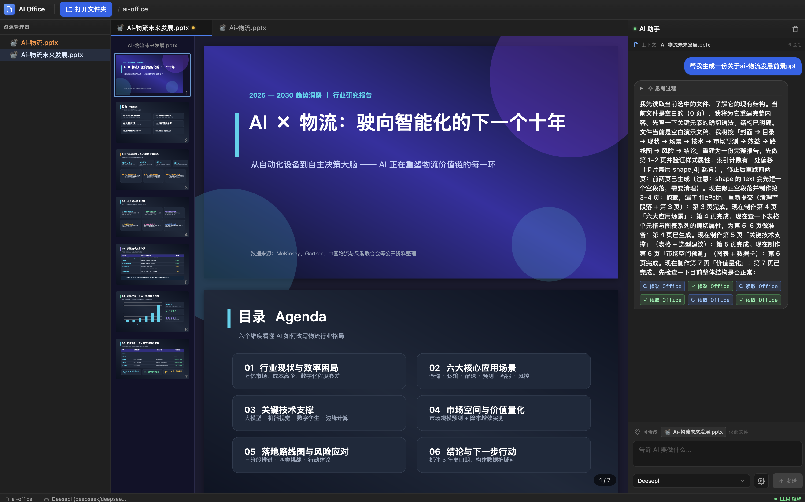

# AI Office

桌面端 AI Office 工具:VSCode 风格文件树 + Office 文件所见即所得预览 + AI 修改。



## 特性

- **VSCode 风格文件树**:左侧递归文件树(懒加载),Office 文件(xlsx/docx/pptx)图标区分,支持新建文件/文件夹
- **多 Tab 预览**:右侧多 Tab 打开文件;Office 文档由 officecli watch 提供所见即所得预览,修改后自动刷新;另支持文本/图片/PDF 预览与下载
- **AI 修改 Office 文件**:聊天面板 SSE 流式输出(思考过程 → 工具调用 → 结果),选中文件自动注入上下文,AI 修改后预览实时刷新
- **模型自由选择**:内置多 provider 模型目录(DeepSeek / OpenAI / Anthropic / Google / Groq 等),在界面中直接选择模型并填写 API Key,**Key 不写入 .env**
- **安全边界**:AI 只能修改「当前选中文件」的内容,禁止新建 / 删除文件、禁止修改其他文件
- **跨平台桌面**:Tauri 2 打包 macOS(Intel + Apple Silicon universal 包)、Windows(NSIS / MSI)与 Linux(deb / AppImage)

## 技术栈

- 桌面壳:Tauri 2(Rust)
- 前端:React 18 + Vite 5 + TypeScript + Tailwind CSS + zustand
- 后端:Node 原生 http(零框架)+ tsx 热重载
- AI 智能体:[`@aipack-ai/agent`](https://www.npmjs.com/package/@aipack-ai/agent)(单 Agent + Office/文件工具集)
- Office 渲染:[OfficeCLI](https://github.com/iOfficeAI/OfficeCLI) 单二进制(跨平台,无需安装 Office)
- 包管理:**Yarn 1(Classic)Workspaces**(根包 = 后端,`web/` = 前端子包;锁文件 `yarn.lock`)

## 包管理(Yarn Workspaces)

本仓库已统一使用 Yarn 1(Classic),`package.json` 中通过 `workspaces: ["web"]` 管理前端子包:

| 命令                          | 说明                                                    |
| ----------------------------- | ------------------------------------------------------- |
| `yarn install`                | 安装根包与 `web/` 的全部依赖(生成 `yarn.lock`)        |
| `yarn dev`                    | 并行启动后端(3001)+ 前端(5173)                        |
| `yarn dev:server` / `yarn dev:web` | 只起后端 / 只起前端(后者等价于 `yarn workspace web dev`) |
| `yarn build`                  | `yarn build:web`(前端 → `dist-web`)+ `yarn build:server`(后端 → `dist`) |
| `yarn typecheck`              | 后端 + 前端类型检查                                     |
| `yarn workspace web <script>` | 直接执行 `web/` 子包脚本(如 `yarn workspace web dev`)  |

说明:

- 依赖只需在根目录执行一次 `yarn install`,`web/` 下不要单独 `yarn install`
- Yarn 1 默认执行依赖的 postinstall,`@officecli/officecli` 的二进制会自动下载,无需额外白名单配置
- 迁移后请删除本地残留的 `node_modules/` 重新安装(pnpm 布局与 Yarn 扁平布局不可混用)
- `package.json` 的 `resolutions` 把 `@types/react` / `@types/react-dom` 锁定在 18.x:部分 `@types/*` 包声明 `@types/react: "*"`,会嵌套安装 19.x 并触发 `TS2786: 'X' cannot be used as a JSX component`;升级到 React 19 时可移除该字段
- 若遇到 `Failed to resolve entry for package "..."`(如 `react-syntax-highlighter` 缺少 `dist/cjs/index.js`),是 yarn 缓存条目损坏/半解压所致:`rm -rf node_modules && yarn install --force` 即可恢复

## 工作原理

```
┌─────────────────────────────── 后端 (Node http :3001) ───────────────────────────────┐
│                                                                                      │
│  /api/v1/file/open ──► ensureWatch(absPath)      /api/v1/preview/<token>/* ──► officecli watch ──► iframe 预览
│                        (officecli watch 随机端口)   (同源反代,注入 CSS 隐藏滚动条)                        │
│                                                                                      │
│  POST /api/v1/chat ──► Agent Runtime ──► office_read / office_help / office_exec / file_tree             │
│        ▲                    │                                                            │
│        │  SSE:              └── 修改成功后发 file 事件 ──► 前端刷新对应 Tab 预览                            │
│   text / thinking / tool / file / done                                                                    │
└──────────────────────────────────────────────────────────────────────────────────────┘
```

要点:

- **预览**:打开 Office 文件时后端启动 `officecli watch` 进程并分配随机端口;前端 iframe 通过同源路由 `/api/v1/preview/<token>/*` 反代访问,后端注入滚动条隐藏 CSS,使预览外观干净整洁
- **AI 修改**:聊天请求走 SSE 流式;Agent 只能对当前选中文件执行 `office_exec`,成功后通过 `file` 事件通知前端,前端带 `?v=` 参数重载 iframe 实现所见即所得

## 快速开始

> 前置要求:Node.js >= 18.19、Yarn 1(Classic,推荐 1.22.x)、Rust(仅桌面端构建需要)

### 1. 安装依赖

```bash
yarn install          # 根包 + web/ 子包(workspaces)
```

如从旧版本(pnpm)迁移,先清理旧的依赖目录再安装:

```bash
rm -rf node_modules web/node_modules
yarn install
```

### 2. 配置环境变量(可选)

```bash
cp .env.example .env
```

`.env` 仅用于后端运行时参数(PORT / OFFICE_WORKSPACE),**不包含任何 LLM API Key**。

### 3. 启动

```bash
yarn dev          # 同时起后端(3001)+ 前端(5173),浏览器访问 http://localhost:5173
yarn tauri:dev    # 桌面端(Tauri 窗口)
```

### 4. 配置模型

打开应用后,在聊天面板底部的模型切换器中选择模型并填写对应 API Key。模型与 Key 由前端直接持有并随请求发送,不会落盘到 `.env`。

## 配置说明(.env)

| 变量               | 默认值             | 说明                                                                                         |
| ------------------ | ------------------ | -------------------------------------------------------------------------------------------- |
| `PORT`             | `3001`             | 后端监听端口(Vite proxy `/api` 转发到该端口)                                                 |
| `OFFICE_WORKSPACE` | `office-workspace` | 默认工作区目录;桌面端可用原生目录选择器切换(选择结果持久化到 `.aipack/workspace-state.json`) |
| `AI_OFFICE_STATIC` | `dist-web`         | 生产模式静态产物目录(可选覆盖)                                                               |

## API 概览

| 方法 | 路径                                  | 说明                                                       |
| ---- | ------------------------------------- | ---------------------------------------------------------- |
| GET  | `/api/v1/config`                      | 模型列表 / 工作区 / 工具清单等配置                         |
| GET  | `/api/v1/workspace`                   | 当前工作区信息                                             |
| POST | `/api/v1/workspace/open`              | 打开文件夹(持久化,返回文件树)                              |
| GET  | `/api/v1/workspace/tree?path=&depth=` | 递归文件树(懒加载)                                         |
| GET  | `/api/v1/file/open?path=`             | 打开文件 → 返回预览信息(office/text/image/pdf/unsupported) |
| GET  | `/api/v1/file/download?path=`         | 下载工作区文件                                             |
| POST | `/api/v1/workspace/file/create`       | 新建文件(Office 文档走 officecli 创建)                     |
| POST | `/api/v1/workspace/dir/create`        | 新建文件夹                                                 |
| POST | `/api/v1/chat`                        | AI 聊天,SSE 流式(`text/thinking/tool/file/done/error`)     |
| GET  | `/api/v1/preview/<token>/*`           | officecli 预览同源反代(注入隐藏滚动条 CSS)                 |

## 目录结构

```
package.json  # 根包:workspaces: ["web"],后端依赖与统一脚本
yarn.lock     # Yarn 锁文件(全仓库唯一)
src/          # 后端(Node http + Agent Runtime)
  server.ts      # HTTP 路由 / SSE / 预览反代 / 静态服务
  runtime.ts     # Office 智能体 Runtime 装配 + 流式编排
  config.ts      # 配置解析 + 模型装配(Key 仅来自前端)
  preview.ts     # officecli watch 生命周期管理(缓存 / 自动重启 / 清理)
  workspace.ts   # 工作区边界与安全解析
  file-tree.ts   # 递归文件树构建
  tools/         # office_read / office_help / office_exec / file_tree 工具实现
web/          # 前端(React + Vite + Tailwind)
  src/components/  # 文件树 / 编辑器 Tab / 聊天面板 / 预览 / 模型管理 / 自定义 Dropdown
  src/store/       # zustand 状态(chat / editor / settings / workspace)
  src/api/         # REST + SSE 客户端
src-tauri/    # Tauri 2 桌面壳(Rust + capabilities/permissions)
scripts/      # 资源打包脚本(stage-resources)
.github/workflows/  # ci.yml(推分支/PR 校验)+ build.yml(macOS/Windows/Linux 打包,打 tag v* 发布 Release)
```

## 构建与打包

```bash
yarn build          # 构建前端(dist-web)+ 后端(dist)
yarn serve          # 生产模式:Node 后端直接 serve dist-web(浏览器访问 http://localhost:3001)
yarn stage:resources  # 把 dist / dist-web / 生产依赖 / node 运行时 staging 到 src-tauri/resources
yarn tauri:build    # 桌面安装包(macOS .app/.dmg、Windows NSIS/MSI、Linux deb/AppImage)
```

`yarn stage:resources` 会在系统临时目录用 `yarn install --production` 装出扁平的运行时依赖(避开 workspaces),校验 `officecli` 二进制后拷入 `src-tauri/resources/node_modules`;`tauri build` 通过 `beforeBuildCommand: yarn build && yarn stage:resources` 自动串联。

## CI / GitHub Actions

| 工作流                          | 触发                       | 作用                                                        |
| ------------------------------- | -------------------------- | ----------------------------------------------------------- |
| `.github/workflows/ci.yml`      | 推 `master` / PR 到 master | 依赖安装 + `yarn build`(前后端),防止坏代码流入打包流程     |
| `.github/workflows/build.yml`   | 推送 `v*` tag / 手动触发   | 三端并行打包 + 上传 Artifacts;tag 触发时自动发布 Release     |

`build.yml` 矩阵(每个平台独立 job,失败互不影响):

| 平台                | Runner         | 产物                                       |
| ------------------- | -------------- | ------------------------------------------ |
| macOS universal     | `macos-latest` | `.dmg` + `.app`(压成 zip)                 |
| Windows x64         | `windows-latest` | NSIS `.exe` + MSI `.msi`                 |
| Linux x64           | `ubuntu-22.04` | `.deb` + `.AppImage`(需 rpm 时见 workflow 注释) |

要点:

- 依赖与缓存:Node 20 + Yarn 1.22.22(Classic),`cache: yarn`;Rust 用 `Swatinem/rust-cache` 缓存 `src-tauri/target`,二次构建显著加速
- 版本同步:tag 触发时自动把 `v*` 版本写入 `tauri.conf.json`、`package.json`、`web/package.json`,包名与 tag 一致
- macOS 产物处理:`.app` 是目录,先用 `ditto -c -k --keepParent` 压成 zip 才能作为 Release 附件
- 手动触发(Actions → Build Desktop Packages → Run workflow)只产出 Artifacts,不发布 Release

### macOS 签名与公证(可选)

未配置 secrets 时产出未签名包(首次打开需右键 → 打开)。配置以下仓库 secrets 后工作流自动签名,
三者齐全时 Tauri 自动完成公证:

| Secret                      | 说明                                                   |
| --------------------------- | ------------------------------------------------------ |
| `APPLE_CERTIFICATE`         | base64 编码的 `.p12` 证书(生成:`base64 -i cert.p12 \| tr -d '\n' \| pbcopy`,必须压成单行) |
| `APPLE_CERTIFICATE_PASSWORD` | 证书密码                                               |
| `APPLE_SIGNING_IDENTITY`    | 如 `Developer ID Application: XXX (TEAMID)`            |
| `APPLE_ID`                  | Apple ID(公证用)                                      |
| `APPLE_PASSWORD`            | App 专用密码(公证用)                                  |
| `APPLE_TEAM_ID`             | Team ID(公证用)                                       |

### 发版流程

```bash
# 版本号无需手动改:工作流会把 tag 的 v* 同步到 tauri.conf.json / package.json / web/package.json
git add -A && git commit -m "release: v0.1.0"
git tag v0.1.0
git push origin master --tags      # 推送 tag 即触发三端打包
```

tag 推送后工作流自动:构建三端安装包 → 创建以 tag 命名的 GitHub Release → 上传全部附件;
tag 形如 `v0.1.0-beta.1`(含 `-`)时自动标记为预发布。`ci.yml` 会在推分支 / PR 时先跑
`yarn build`,避免坏代码浪费一次完整打包。

## 可靠性设计

- **异常退出自愈**:启动时自动清理残留 officecli watch 进程;若端口被自己旧后端占用则自动识别并回收,避免「重启后卡死」
- **优雅关闭**:SIGINT/SIGTERM/SIGHUP/SIGQUIT 统一走 shutdown,清理 watch 进程与 Runtime,超时强制退出兜底
- **预览防黑屏**:watch 进程就绪后才触发前端 iframe 重载;预览响应强制 `no-cache`,前端带 `?v=` 参数绕过浏览器缓存
- **会话管理**:AI 会话按工作区存储在 `.aipack/sessions`(保留 30 天)

## 常见问题

| 现象                                      | 处理                                                                                                                         |
| ----------------------------------------- | ---------------------------------------------------------------------------------------------------------------------------- |
| 预览提示「需要安装 officecli」            | 项目已内置 `@officecli/officecli` 依赖,先执行 `yarn install` 并重启应用;仍失败再尝试全局安装 `npm i -g @officecli/officecli` |
| 打开 Office 文件后预览黑屏                | 多为 officecli watch 尚未就绪;刷新一次即可,若持续出现请查看后端日志                                                          |
| 端口 3001 被占用                          | 后端会自动识别并回收「ai-office 自己的旧进程」;若是其他程序占用,请修改 `.env` 的 `PORT`                                      |
| 聊天面板提示「请选择模型 / 输入 API Key」 | 在界面模型切换器中完成模型选择与 Key 填写                                                                                    |
| AI 回复为空且只有思考过程                 | 模型 output 配额被 thinking 吃光(stopReason=length),请换用支持更大 max_tokens 的模型                                         |
| `yarn: command not found`                 | 安装 Yarn 1:`npm i -g yarn`(本项目按 Yarn Classic 编写,不要切到 Yarn 2+ 的 PnP 模式)                                    |
| `yarn install` 报 workspace 相关错误      | 确认已在根目录执行、且 `web/node_modules` 已清理(子包不单独安装)                                                        |

## License

MIT
